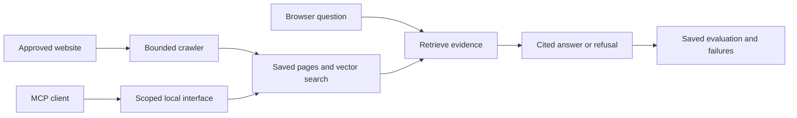

# Instant Front Desk

Turn a business's saved website pages into a local assistant that answers questions with source citations, refuses unsupported requests and shows a score card of saved evaluations. The goal is simple: check what the assistant can answer before asking an owner to trust it.

I build with AI coding agents, directing the workflow and checking examples and failures. **Instant Front Desk is a local portfolio prototype. There is no public app deployment or customer-use evidence.**

**See the idea in two minutes:** [fictional MCP transcript](docs/mcp-demo-transcript.md) · [MCP case study](docs/mcp-case-study.md) · [run the fictional demo](#try-the-fictional-demo)

Bosko Tutnjilovic · AI Automation Engineer · [Synq Logic](https://synqlogic.com)

## A question, an answer and a limit

The fictional walkthrough uses Maple Street Dental. It demonstrates a cited Saturday-hours answer, a refusal to invent an exact checkup price and rejection of invalid input. The business and saved evaluation are invented; its `.test` address is never fetched.

The demo runs the real MCP protocol and application checks with scripted model replies. It demonstrates tool discovery, data flow, citations and refusal behavior. It does **not** measure live-model answer quality.

## Try the fictional demo

Requires Node.js 22+ and npm.

```bash
git clone https://github.com/skabo42000/instant-front-desk.git
cd instant-front-desk
npm ci
npm run mcp:demo
```

The demo uses a disposable in-memory database. It needs no model keys, saved business database or network listener and makes no external calls after dependencies are installed. It prints results and regenerates `docs/mcp-demo-transcript.md`.

To check the fictional session without rewriting that transcript:

```bash
npm run mcp:smoke
```

See [MCP setup and limits](docs/mcp.md) for host configuration and the separate real-app connection. The scripted SDK client is not evidence that an AI assistant autonomously selected every tool in a real-business session.

## What the application does

- Collects approved public pages from one exact website origin, with private-address checks, robots.txt handling and page, size and time limits.
- Stores page chunks and embeddings, retrieves relevant evidence and returns cited answers or refusals.
- Saves versioned questions and evaluation reports so failures can be inspected instead of hidden inside an average score.
- Separates retrieval, grounding and completeness checks. Real answer evaluations use a judge from a different model family.
- Provides a read-only MCP interface to scoped business and evaluation information, alongside the documented cited-answer path.



The project uses Next.js, TypeScript and Tailwind, local Postgres through PGlite with pgvector, Gemini answers/embeddings and a separate Groq judge. Hosted pilot controls are a separate configuration from local use.

## Recorded evidence

On October 17, 2026, the prototype was evaluated on two owned websites, with 26 questions per site. Gemini answers were graded by Groq `gpt-oss-120b` for grounding, completeness and correctness.

| Website | Passed all three checks | Execution errors |
| --- | --- | --- |
| Synq Logic | 24/26 | 0 |
| European Beauty Lounge | 22/26 | 1 grader error |

The questions were reviewed by AI, not human-labeled, and the grader has not been calibrated against human labels. These are small owned-site benchmarks, not customer results or human-validated accuracy. Errors and missing checks do not count as passes. Different snapshots, questions or judge versions must not be treated as the same benchmark.

Other dated local evidence includes a direct-SQL Postgres control test: 24 simultaneous requests against a limit of 3 produced exactly 3 accepted requests and no errors. That checks the recorded database control, not a hosted API or Supabase deployment.

Read [evaluation foundations](docs/evaluation-foundation.md), [AI question-review provenance](docs/ai-review.md) and [validation notes](docs/validation.md). Public [benchmark fixtures](benchmarks/README.md) support offline comparisons. Full private reports and local databases are not part of a clean clone.

## Open the local web app

After installing dependencies:

```bash
npm run dev
```

Open `http://127.0.0.1:3000`. The server binds to loopback. A new clone does not contain your private saved business database. Default fake chat refuses questions; adding provider keys alone does not enable live chat. Use the fictional MCP demo above for an immediate, provider-free example.

Stop the web server before running a database CLI against the same local database. PGlite supports only one process on that folder. See [ingestion](docs/ingestion.md) for loading an approved site and the separate live-chat setup, account checks and call limits.

Live ingestion, answers and judging send content to providers and consume quota. A “free tier confirmed” setting is an operator confirmation, not a billing guarantee. There is no automatic paid upgrade.

## Offline checks

```bash
npm run typecheck
npm test
NEXT_TELEMETRY_DISABLED=1 npm run build
```

The tests use fictional sites, scripted models and injected transports. Their success checks implementation behavior, not real-model quality. GitHub-hosted CI is not enabled yet.

## Where to inspect the work

| Path | Purpose |
| --- | --- |
| `docs/mcp.md`, `docs/mcp-case-study.md` | Protocol, security boundaries, fictional walkthrough and real-app setup |
| `docs/evaluation-foundation.md`, `docs/ai-review.md` | Versioning, scoring dimensions and AI-review provenance |
| `benchmarks/` | Saved public fixtures and retrieval comparisons |
| `docs/ingestion.md`, `docs/validation.md` | Local loading, provider setup and dated validation |
| `db/`, `src/`, `tests/` | Migrations, implementation and offline checks |
| `docs/pilot.md` | Controlled pilot configuration and remaining gates |

## Limits

Website text is untrusted input. Crawler safeguards, prompts and answer checks do not prove resistance to every injection or unsupported statement. AI-reviewed labels remain provisional.

Local limits reset with the process. Pilot configuration has shared Postgres counters and persistent provider-call budgets, but implementation and local SQL checks do not establish hosted readiness. Human grader calibration, public deployment and customer outcomes remain separate evidence gates.

Read [SECURITY.md](SECURITY.md) before using real data or exposing a service. All rights reserved. The source is public so it can be reviewed as a portfolio project; please ask before reusing it.
